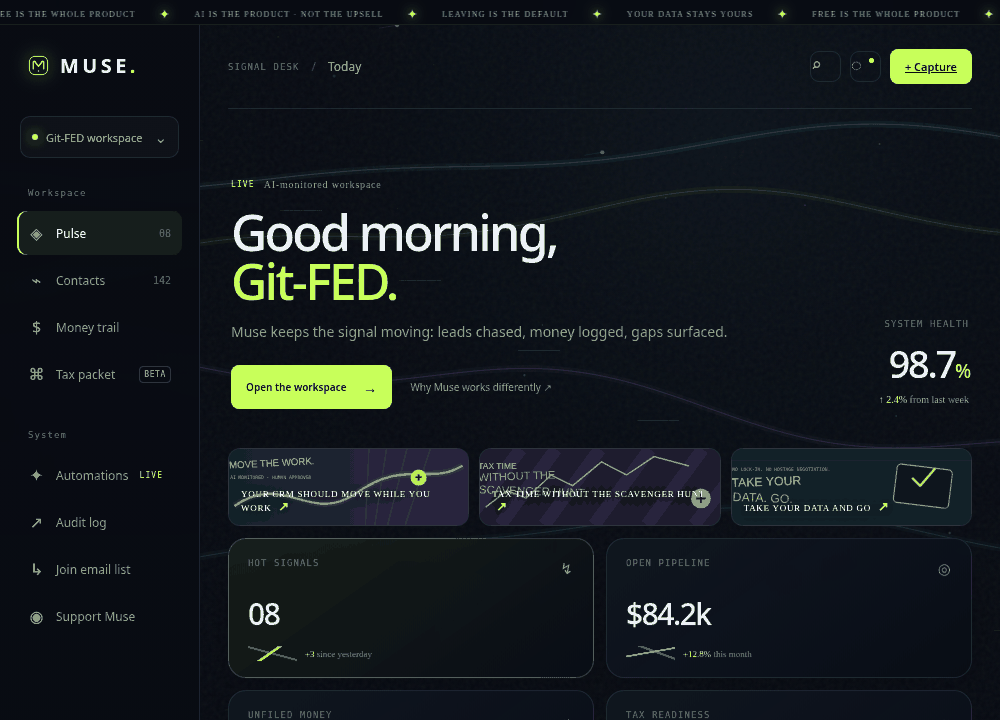
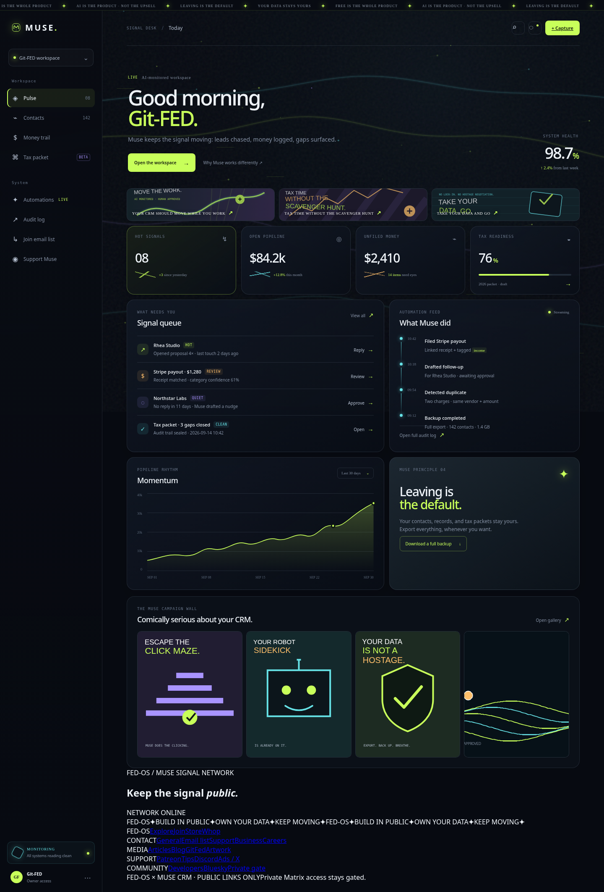
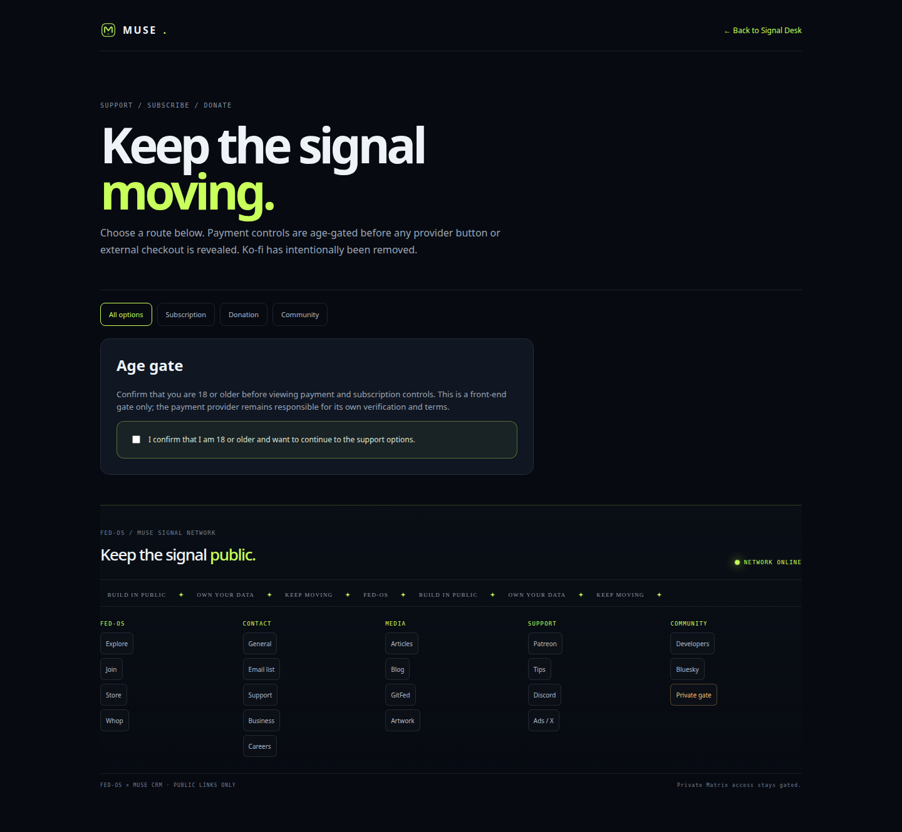
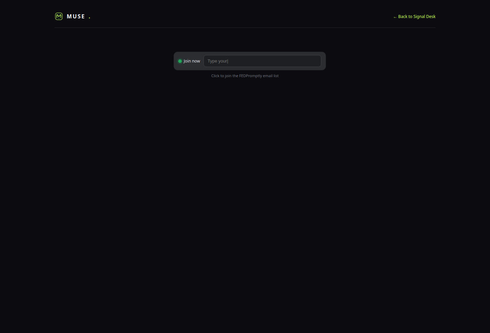
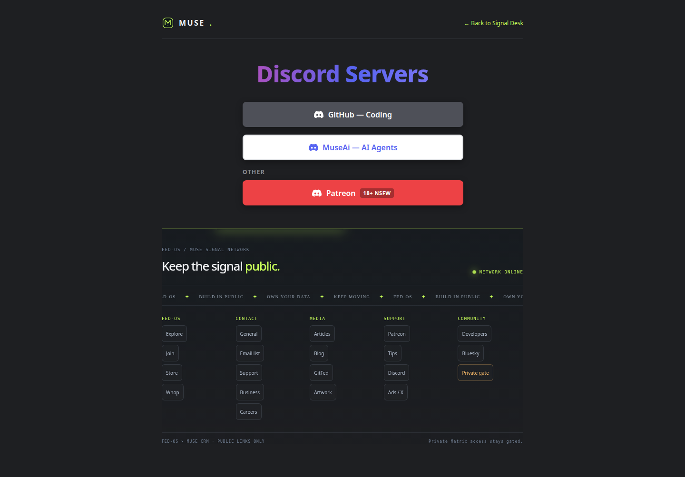

# Muse CRM — Signal Desk

A dark, browser-based CRM that turns contacts, pipeline, money, and follow-up work into a reviewable daily signal desk.

**Version:** `0.2.0` · **Runtime:** plain HTML, CSS, and browser JavaScript · **Build step:** none

> Muse is intentionally presented as a review and organization layer. The interface says “Compiled for review — not filed”; it does not claim to file tax returns, act as a CPA, or provide tax advice.

## Why this exists

Small teams lose time moving between inboxes, payment records, follow-up lists, exports, and tax-preparation folders. The important work is often not “more dashboards”; it is knowing which signal deserves attention now, why it surfaced, and what can be safely reviewed or exported later.

Muse explores a different interaction model: a calm command center with a signal queue, human approval points, an audit trail, money and tax routes, and a campaign wall that makes the product feel like a real working environment rather than a collection of disconnected forms.

The project is useful to designers and front-end developers who want a runnable reference for:

- A dark, non-orbital animated background built from flowing signal ribbons, scan traces, particles, and glow.
- A usable local CRM workspace with persistent browser data, real forms, search, task completion, and export/import.
- Review-oriented flows for contacts, money trails, automations, audit logs, tax packets, and exports.
- A public/private navigation model for support, community, age-gated payment controls, and restricted community access.
- A browser-only prototype that can be opened locally without a framework or package install.

## See it work

There is **no confirmed live demo URL in this checkout**. The repository does include a GitHub Pages workflow and an optional Cloudflare Pages configuration, but neither deployment is verified here.

The fastest real demo is the actual application captured from a local server:



### Run it in under a minute

```bash
cd muse-crm-template
python3 -m http.server 8000
```

Open [http://localhost:8000](http://localhost:8000), click **+ Capture**, create a contact or deal, then verify it in **Contacts**, **Search**, and **Money trail**. Use **Full export** to download a JSON backup.

The main entry point is [`index.html`](index.html). The fastest working CRM flow is **Capture → Contacts → Search → Money trail → Full export**. Login stays inline in the dashboard header; core CRM data does not require an account or backend.

## Screenshots

### Signal Desk dashboard



### Age-gated support route



### Email-list access route



### Community route



## Quick start

### Install

There is nothing to install for the core dashboard. Python is only used below as a convenient local static server.

```bash
cd muse-crm-template
```

### Run

```bash
python3 -m http.server 8000
```

Then visit <http://localhost:8000>.

If Python is unavailable, serve the directory with any static-file server. Do not open the HTML files directly from `file://` if you want every relative route and browser behavior to match a hosted deployment.

### Smoke test

No automated test suite is defined in `package.json`. A useful local smoke test is:

```bash
python3 -m http.server 8000 >/tmp/muse-crm-server.log 2>&1 &
server_pid=$!
curl --fail http://127.0.0.1:8000/index.html >/dev/null
curl --fail http://127.0.0.1:8000/pages/payments.html >/dev/null
curl --fail http://127.0.0.1:8000/pages/join-email.html >/dev/null
kill "$server_pid"
```

The only package script currently defined is:

```bash
npm start
```

It runs the same Python static server on port `8000`; `npm install` is not required because the package has no runtime dependencies.

## Useful routes

| Route | What it demonstrates |
| --- | --- |
| [`index.html`](index.html) | Live Signal Desk with local CRM counts, open-task queue, pipeline, and animated background. |
| [`pages/contacts.html`](pages/contacts.html) | Persistent contact table with search, stage filtering, edit, delete, and pipeline totals. |
| [`pages/money-trail.html`](pages/money-trail.html) | Live pipeline and transaction ledger with income, expenses, and net totals. |
| [`pages/tax-packet.html`](pages/tax-packet.html) | Tax-packet review language and export-oriented flow. |
| [`pages/audit-log.html`](pages/audit-log.html) | Explanation and traceability route. |
| [`pages/automations.html`](pages/automations.html) | Automation review route. |
| [`pages/export.html`](pages/export.html) | JSON backup, restore, record counts, and local-workspace reset. |
| [`pages/capture.html`](pages/capture.html) | Working forms for contacts, deals, transactions, and follow-up tasks. |
| [`pages/search.html`](pages/search.html) | Workspace-wide search across contacts, deals, money, and tasks. |
| [`pages/payments.html`](pages/payments.html) | Front-end age gate before external support/payment controls. |
| [`pages/join-email.html`](pages/join-email.html) | Supabase-backed email-list signup, sign-in, password reset, session, and logout UI. |
| [`pages/discord.html`](pages/discord.html) | Public community buttons, Echoed server preview, plus a confirmation flow for the 18+ option. |
| [`pages/private-communities.html`](pages/private-communities.html) | Age-and-country eligibility gate for restricted community access without exposing the private Matrix invite. |
| [`pages/promo-gallery.html`](pages/promo-gallery.html) | Comic-style campaign assets and the animated signal loop. |

## Project map

```text
index.html                    Main static entry point
styles.css                    Dashboard layout, visual system, ticker, and motion
pages.css                     Shared route-page styles and animated FED-OS footer
app.js                        Procedural canvas background and lightweight interactions
pages/                        Linked static HTML routes
assets/                       Brand marks, favicon, campaign art, and demo captures
404.html                      Branded missing-route page
_headers                      Cloudflare Pages headers
wrangler.toml                 Optional Cloudflare static-assets configuration
.github/workflows/pages.yml   GitHub Pages deployment workflow
package.json                 Metadata and the npm start shortcut
```

## Design direction

The visual system is deliberately dark, high-contrast, and slightly editorial: near-black surfaces, cool blue-gray structure, acid-lime action color, thin borders, signal traces, and compact monospace labels.

The background is **not orbital**. It uses procedural flowing ribbons, scan traces, drifting particles, and restrained glow so the interface feels alive without turning the workspace into a space dashboard. Motion-reduction preferences are respected in the main animation and route treatments.

The public footer uses shortened FED-OS buttons and an animated marquee. Public landing pages remain linkable, while restricted community access stays behind a separate age-and-country gate.

## Configuration and external services

Most routes are self-contained static HTML. Two areas intentionally depend on external services supplied by the project content:

- The dashboard’s inline Login control and `pages/join-email.html` load the Supabase browser client and use the configured publishable key for email signup, sign-in, password reset, and session handling. The repository does not include server-side credentials or a backend.
- `pages/payments.html` contains external provider controls and links. The age gate is only a front-end confirmation layer; it is not legal, identity, or payment-provider verification.

External provider URLs and checkout controls should be reviewed before using this package in production.

## Deployment status

### GitHub Pages

A workflow exists at [`.github/workflows/pages.yml`](.github/workflows/pages.yml). It uploads the repository root as a Pages artifact on pushes to `main` and on manual dispatch. A repository administrator still needs to enable GitHub Pages with **GitHub Actions** in the repository settings. No live Pages URL is claimed here because the repository identity and deployment status are not available in this checkout.

### Cloudflare Pages / Workers

[`wrangler.toml`](wrangler.toml) describes the current directory as static assets. It is an optional starting point; replace the project name and configure the target account/project before deploying. No Cloudflare deployment is claimed here.

## What this is—and is not

This is a standalone browser CRM that is usable for a single workspace on one browser. It is not a hosted multi-user CRM backend, a tax filing service, a CPA, a payment processor, an email-delivery system, or a complete authentication service.

The core CRM data is stored in browser localStorage, so clearing site data removes the workspace unless you first use Full export. There are no automated tests, no confirmed live demo, and no repository license file. These are intentional facts about this checkout.

## License

No license file is included. Until the project owner adds one, treat the contents as **all rights reserved** and do not assume permission to redistribute or reuse the code or artwork.
